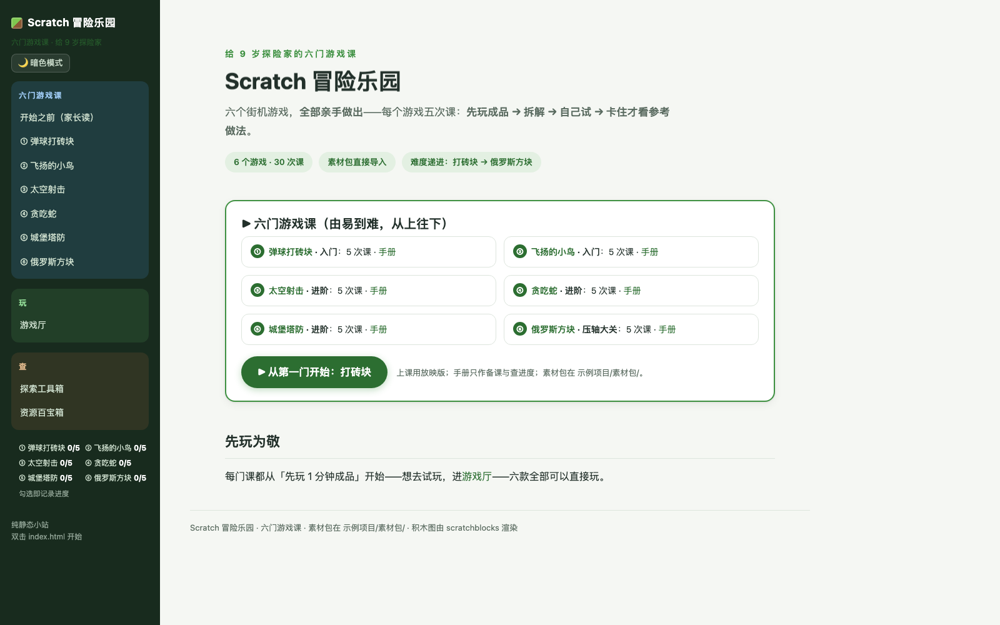
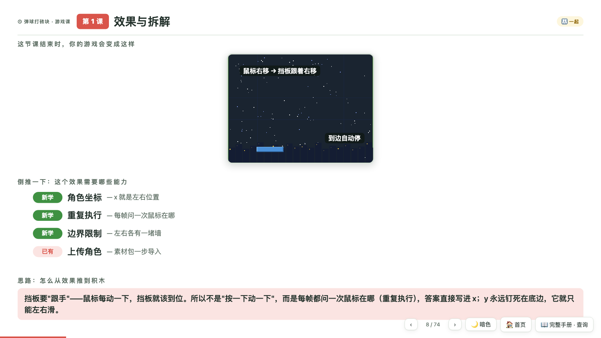
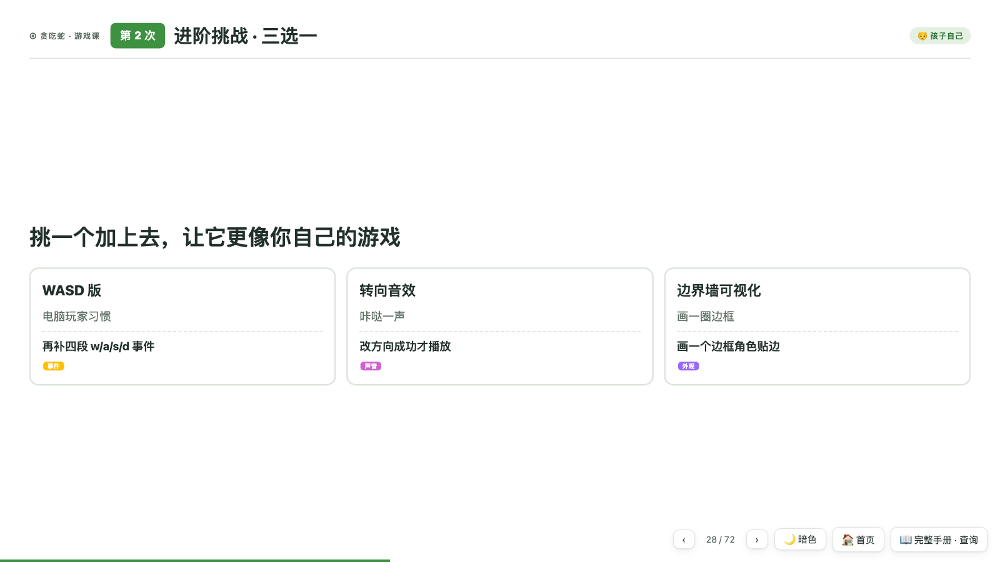
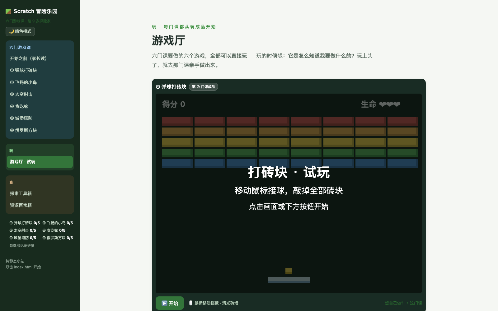

# 🎮 Scratch Game Course · Build Six Games With Your Own Hands

> A complete Scratch 3 curriculum for kids (~age 9): six classic arcade games, five lessons each, **built entirely by the child** — play the finished game first, tear it apart, then build it yourself.

[中文](README.md) | Pure static site · Double-click to run · No install · No internet needed



## ✨ What Makes This Different

**Play → Tear Apart → Build** — every course, every lesson follows the same learning line:

```
Play the finished game (1 min) → Anatomy diagram (top-down breakdown)
→ Try it yourself (10 min) → Only when stuck: reference steps
→ Acceptance check → Experiments / Debugging / Challenges → Recap
```

- 🎯 **One thing per lesson**: each lesson adds exactly one core concept, and the game visibly changes when you finish
- 🧩 **Real Scratch 3 block images**: every script is rendered with [scratchblocks](https://scratchblocks.github.io/) in official Scratch 3 style — identical to what kids see in the editor, with drawer hints showing which category each block lives in
- 🎨 **Ready-made asset packs**: all sprites packaged as standard `.sprite3` files — one-click import via "Upload Sprite", no drawing required
- 🧠 **Thinking, explained**: every lesson has a "reasoning chain" — the inference from effect all the way down to blocks. We teach how to think, not copy-paste
- 👨‍👩‍👦 **Parent/child roles**: every section is tagged (parent-read / together / kid-alone), with one-click filtering in the web handbook
- ⭐ **Progress system**: check off each lesson, stars light up on the home page (stored in localStorage)

## 🕹️ The Six Courses

| # | Course | Level | What You Build | Core Skills |
|---|--------|-------|----------------|-------------|
| ① | Brick Breaker | Beginner | A complete winnable/losable breakout | Coordinates · loops · cloning · collision · scoring |
| ② | Flappy Bird | Beginner | Gravity jump + endless pipes | Velocity integration · events · "the world moves" |
| ③ | Space Shooter | Intermediate | Bullet-hell vs asteroid rain | Clone bullets · random spawning · clone-vs-clone hits |
| ④ | Snake | Intermediate | Grid world, grow by eating | Grid movement · lists as the snake's memory |
| ⑤ | Tower Defense | Intermediate | Build towers, defend the castle | Path navigation · economy loop · auto-combat |
| ⑥ | Tetris | Grand finale | A complete Tetris | Map lists · shape data · line-clear algorithm |

Each course = **one presentation deck (427 slides total) + one full-text handbook**, generated from the same source — edit once, both update.



*Deck · "Effect & Breakdown" page: left shows what the game looks like at the end of this lesson; right is the reverse-engineered skill list (have / new).*



*Reference steps, shown only when stuck: real Scratch 3 block images + drawer hints + ✅ self-checks.*

## 🎮 Arcade: Play Before You Build

All six finished games are **playable web demos** — every course starts by playing the real thing, then building your own.



## 📁 Repository Layout

```
├── index.html              # Home: course hub
├── 页面/ (pages)
│   ├── outline.html        # Before You Start (for parents)
│   ├── handbook-brick … tetra.html   # Six full-text handbooks
│   ├── games.html          # Arcade (six playable demos)
│   ├── toolbox.html        # Explorer's toolbox
│   └── resources.html      # Resource vault
├── 放映版/ (decks)          # Six presentation decks (main teaching UI)
├── assets/
│   ├── sprites/<game>/     # 31 pixel-art SVGs, organized per game
│   └── vendor/             # scratchblocks (works offline)
├── 示例项目/素材包/<game>/   # 17 .sprite3 asset packs (one-click import)
├── 生成讲义PPT.py           # Regenerate decks: python3 生成讲义PPT.py
└── 示例项目/生成素材包.py     # Repackage .sprite3 assets
```

## 🚀 Quick Start

**Option 1 (recommended)**: Download, double-click `index.html` — pure static site, no server, no install, no internet.

**Option 2**: Run a local server:

```bash
python3 -m http.server 8000
# Open http://localhost:8000
```

**Teach**: Open any course → click "▶ Open presentation deck" on the handbook page → arrow keys to navigate, F for fullscreen.

**Prep**: Read [Before You Start](页面/outline.html) (10 min), stage the `.sprite3` packs from `示例项目/素材包/`.

> Note: the course content is written in Chinese. English translations are welcome via PR!

## 🛠️ Regenerate From Source

Course content lives in each handbook's `<template class="deck-src">`. After editing, regenerate all decks with one command:

```bash
python3 生成讲义PPT.py
```

Repackage sprites after asset edits:

```bash
python3 示例项目/生成素材包.py
```

Tech: pure HTML/CSS/JS, zero dependencies, zero build steps; blocks rendered by scratchblocks (offline copy bundled); light/dark themes; responsive.

## 🗓️ Pace

- 5 lessons × 30–45 min per course, 30 lessons total
- Recommended order ①→⑥ (difficulty ramps up), or let the kid pick
- ~7 months at one lesson per week; ~2 months fast track

## 🤝 Contributing

- Found a wrong block image, link, or typo? Open an issue or PR
- Want to add a 7th game? Write content into a handbook template and run the generator
- Ideas to improve the pedagogy (play→breakdown→DIY→reference)? Especially welcome

## 📄 License

[MIT](LICENSE) — free to use for teaching, remixing, and sharing (just keep the license).

Block images rendered by [scratchblocks](https://scratchblocks.github.io/) (see `assets/vendor/` for its license).
