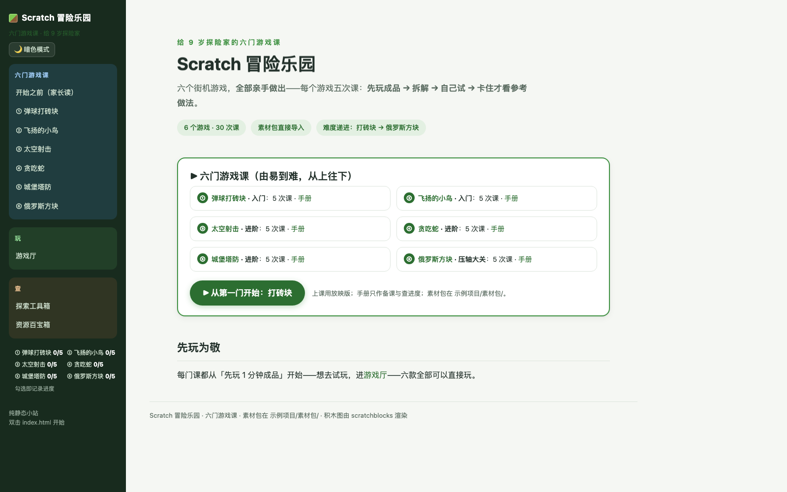
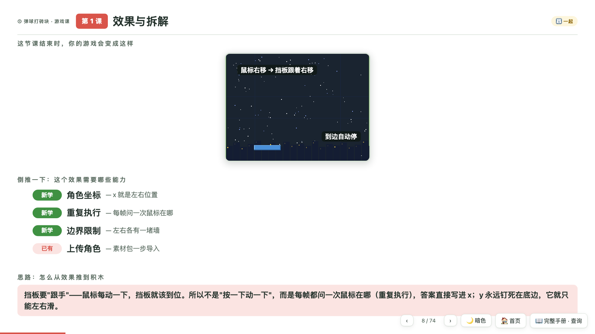
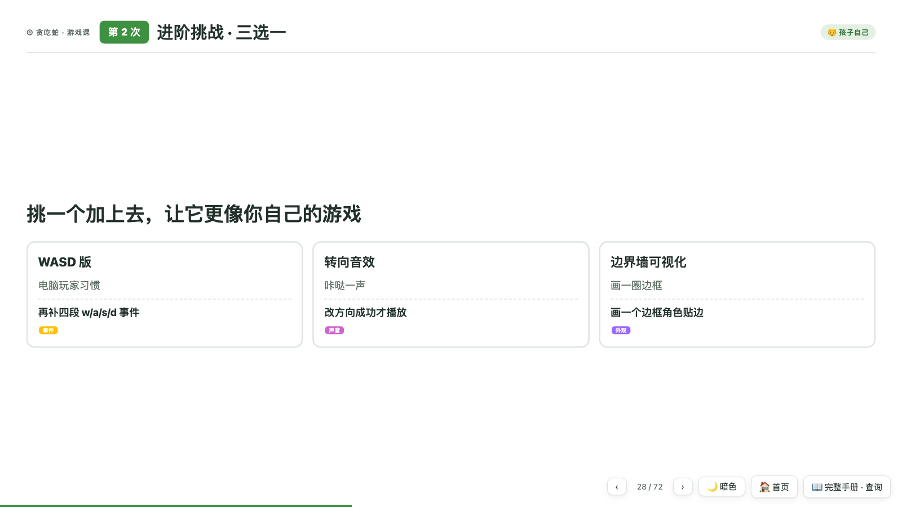
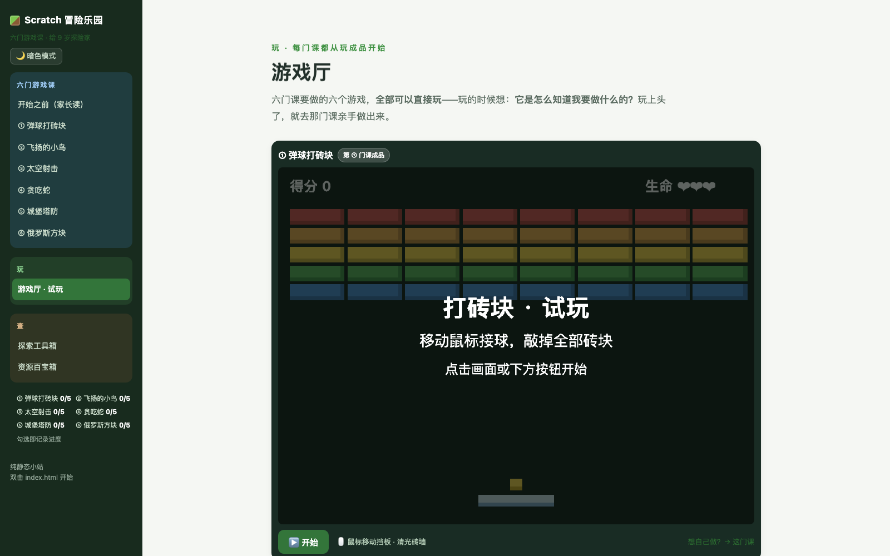

# 🎮 Scratch 游戏课 · 八个游戏亲手做

> 给 9 岁左右孩子的 Scratch 3 完整课程：八个经典街机游戏，每个五次课，**全部亲手做出成品**——先玩成品、拆解它、再自己动手做。

[English](README.en.md) | 纯静态 · 双击即用 · 无需安装 · 无需联网



## ✨ 这个课程有什么不一样

**先玩、再拆、后做**——每门课、每一课都遵循同一条学习线：

```
先玩 1 分钟成品 → 游戏解剖图（自上而下拆解）→ 自己试 10 分钟
→ 卡住了才看「参考做法」→ 验收 → 试一试 / 排错 / 挑战 → 本作总结
```

- 🎯 **每课只解决一件事**：一次课只新增一个核心概念，做完就能看到游戏变化
- 🧩 **真实的 Scratch 3 积木图**：全部脚本用 [scratchblocks](https://scratchblocks.github.io/) 按 Scratch 3 官方外观渲染，和编辑器里看到的一模一样，还标注了每块积木在哪个类别抽屉
- 🎨 **素材包直接导入**：全部角色打包成 Scratch 标准 `.sprite3` 文件，编辑器里「上传角色」一步导入，不用现场画图
- 🧠 **思路讲透**：每课都有"思路链"——从效果一路倒推到积木的推理过程，教的是怎么想，不是照抄
- 👨‍👩‍👦 **亲子分工**：每一段都标了「家长先看 / 一起做 / 孩子自己」，网页手册可一键筛选只看某一类
- ⭐ **进度系统**：每课上完勾一格，首页星星同步亮，本地 localStorage 存储

## 🕹️ 八门游戏课

| # | 课程 | 难度 | 做出什么 | 核心技能 |
|---|------|------|---------|---------|
| ① | [弹球打砖块](页面/handbook-brick.html) | 入门 | 能赢能输的完整打砖块 | 坐标 · 循环 · 克隆 · 碰撞 · 计分 |
| ② | [飞扬的小鸟](页面/handbook-flappy.html) | 入门 | 重力跳跃 + 无尽管道 | 速度积分 · 事件 · "世界在动" |
| ③ | [太空射击](页面/handbook-shooter.html) | 进阶 | 弹幕射击 + 陨石雨 | 克隆弹幕 · 随机生成 · 克隆体互撞 |
| ④ | [贪吃蛇](页面/handbook-snake.html) | 进阶 | 格子世界 + 越吃越长 | 格子移动 · 列表当身体的记忆 |
| ⑤ | [城堡塔防](页面/handbook-tower.html) | 进阶 | 造塔守城 + 金币经济 | 路径导航 · 经济循环 · 自动战斗 |
| ⑥ | [俄罗斯方块](页面/handbook-tetra.html) | 压轴 | 完整俄罗斯方块 | 地图列表 · 形状数据 · 消行算法 |
| ⑦ | [跳跳冒险](页面/handbook-platform.html) | 进阶 | 马里奥式平台跳跃 | 碰到颜色 · 平台碰撞 · 踩踏判定 · 关卡设计 |
| ⑧ | [坦克大战](页面/handbook-tank.html) | 进阶 · 双人 | 双人对战坦克决斗 | 双人操控 · 带方向的子弹 · 可破坏地形 · 赛制 |

每门课 = **一本放映版（577 页幻灯片总计）+ 一本全文手册**，内容同源，改一处两边同步。



*放映版 · 效果与拆解页：左边是这节课结束时游戏的样子，右边是从效果倒推出来的能力清单（已有 / 新学）*



*卡住才看的「参考做法」：真实 Scratch 3 积木图 + 抽屉提示 + ✅ 自查点*

## 🎮 游戏厅：先玩为敬

八款成品全部做成了**可直接玩的网页 Demo**（打砖块 / 小鸟 / 射击 / 贪吃蛇 / 塔防 / 俄罗斯方块 / 跳跳冒险 / 坦克大战）——每门课从"玩别人做好的"开始，玩上头了再去课程里亲手做。



## 📁 目录结构

```
├── index.html              # 首页：课程入口
├── 页面/
│   ├── outline.html        # 开始之前（家长读）
│   ├── handbook-brick … tank.html    # 八本全文手册
│   ├── games.html          # 游戏厅（八款可玩 Demo）
│   ├── toolbox.html        # 探索工具箱
│   └── resources.html      # 资源百宝箱
├── 放映版/                  # 八本放映版 deck（上课主界面，方向键翻页）
├── assets/
│   ├── sprites/<游戏名>/    # 54 个像素风 SVG 素材（按游戏分目录）
│   └── vendor/             # scratchblocks（离线可用）
├── 示例项目/素材包/<游戏名>/  # 29 个 .sprite3 角色包（上传角色一步导入）
├── 生成讲义PPT.py           # 从手册生成放映版：python3 生成讲义PPT.py
└── 示例项目/生成素材包.py     # 重新打包 .sprite3 素材包
```

## 🚀 快速开始

**方式一（推荐）**：下载后双击 `index.html`——纯静态站点，无需服务器、无需安装、无需联网。

**方式二**：起个本地服务器（中文路径更友好）：

```bash
python3 -m http.server 8000
# 浏览器打开 http://localhost:8000
```

**上课**：进入任一门课 → 手册页点「▶ 打开放映版，开始上课」→ 方向键翻页、F 全屏。

**备课**：读 [开始之前（家长读）](页面/outline.html)（10 分钟），把 `示例项目/素材包/` 里的 `.sprite3` 备好。

## 🛠️ 从源码重新生成

内容写在手册 HTML 的 `<template class="deck-src">` 里，改完后一条命令重新生成放映版：

```bash
python3 生成讲义PPT.py
```

改素材后重新打包角色：

```bash
python3 示例项目/生成素材包.py
```

技术栈：纯 HTML/CSS/JS，零依赖零构建；积木图由 scratchblocks（已内置离线副本）渲染；亮暗双主题；响应式布局。

## 🗓️ 课程节奏

- 每门课 **5 次课 × 30–45 分钟**，八门共 40 次课
- 建议顺序 ①→⑧（难度递进；⑥ 俄罗斯方块是算法压轴，⑦⑧ 是动手实战双番外），也可以让孩子挑喜欢的先做
- 每周一次约 9 个月；速通约 2 个半月

## 🤝 欢迎Contributing

- 发现积木图/翻译/链接错误：直接提 Issue 或 PR
- 想加第九门游戏：内容写在 `页面/handbook-<游戏>.html` 的 template 里，并在 `生成讲义PPT.py` 的 DECKS 与 `示例项目/生成素材包.py` 里登记，再跑一遍两个生成脚本
- 想改进课程理念：最欢迎——这套"先玩→拆解→自试→参考"的流程本身就在持续迭代

## 📄 许可证

[MIT](LICENSE) —— 课程内容可自由用于教学、改编、二次分享（附上许可证即可）。

积木图渲染由 [scratchblocks](https://scratchblocks.github.io/) 提供（其自身许可见 `assets/vendor/`）。
